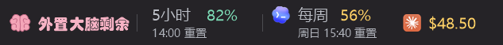
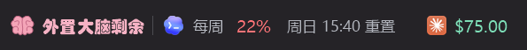

# Codex 任务栏额度看板

打开 Codex 桌面应用后，Windows 任务栏看板会显示 Codex 剩余额度和重置时间，也可通过 Edge 登录状态读取 OpenAI API 的美元余额。左侧 Codex 额度每分钟刷新，右侧 Claude 图标旁的 API 余额每 5 分钟刷新。关闭 Codex 窗口后看板会隐藏并暂停查询，最小化时仍会显示。

## 界面预览

**同时返回 5 小时和每周额度**



**只返回每周额度**



图中的百分比、重置时间和 API 余额均为示例。实际显示的 Codex 额度取决于本机返回的窗口。API 余额低于 $34 显示红色，$34 至 $66.99 显示黄色，$67 起显示绿色。

## 使用条件

- Windows，.NET Framework 4.x（构建需要系统自带的 C# 编译器）
- 安装并登录 Codex 桌面版；程序在 `%LOCALAPPDATA%\OpenAI\Codex\bin` 中查找 `codex.exe`
- 主屏幕使用底部任务栏；任务栏隐藏或前台全屏时看板自动隐藏

显示 API 余额还需要标准 Windows 安装的 Node.js、通过 npm 安装在用户默认目录中的 [OpenCLI](https://github.com/jackwener/opencli)，以及与 OpenCLI Browser Bridge 连接的 Edge。在该浏览器配置中登录 [OpenAI Platform](https://platform.openai.com/home)。程序读取首页的 `Credit remaining`，无需 API Key 或管理员 Key。

看板会使用 OpenCLI 的默认浏览器配置。如果连了多个配置，可在 PowerShell 中设置希望使用的配置别名，再退出并重新打开看板：

```powershell
[Environment]::SetEnvironmentVariable('CODEX_TASKBAR_OPENCLI_PROFILE', 'my-edge', 'User')
```

## 启动

1. 将整个项目放在有写入权限的固定目录，保留 `app` 和 `work` 的相对位置。
2. 右键 `app/启用自动启动.ps1`，选择“使用 PowerShell 运行”，配置当前用户登录任务，使看板在后台等待 Codex 打开。该步骤不会要求管理员权限或保存密码；同名任务会被更新。
3. 双击 `app/CodexTaskbarUsage.exe` 启动。也可从 PowerShell 在该目录运行 `./CodexTaskbarUsage.exe --detached`，不创建自动启动任务。

任务计划程序引用可执行文件的绝对路径，移动目录后需重新运行自动启动脚本。右键看板可刷新、恢复位置、设置自动启动或退出；双击刷新两项，拖动可调整位置。Codex 百分比带 `*` 表示保留了上次读数。API 余额查询失败时也会保留上次读数，鼠标悬停可查看更新时间和失败说明。尚无读数时显示 `--`。重置时间按本机时区显示。

## 从源码构建

在 PowerShell 中运行 `./build.ps1`，输出到 `app/CodexTaskbarUsage.exe`。构建不会自动启动或安装程序。若程序正在运行，请先退出再覆盖可执行文件。源码基于 .NET Framework WinForms，无需 NuGet 依赖。运行 `./test.ps1` 可验证窗口识别和额度计算。

## 数据与隐私

Codex 额度来自本机 `app-server` 的 `account/rateLimits/read` 接口。API 余额通过独立的 OpenCLI 浏览器会话读取页面可见字段。程序不保存 API Key 或浏览器登录凭据。位置设置、用量状态、余额缓存和运行日志存于本机 `work/runtime`，这些文件不纳入版本控制。

本项目是独立工具。Codex 和 Claude 图标分别来自 OpenAI 和 Anthropic 的应用，标识归各自权利人所有。
